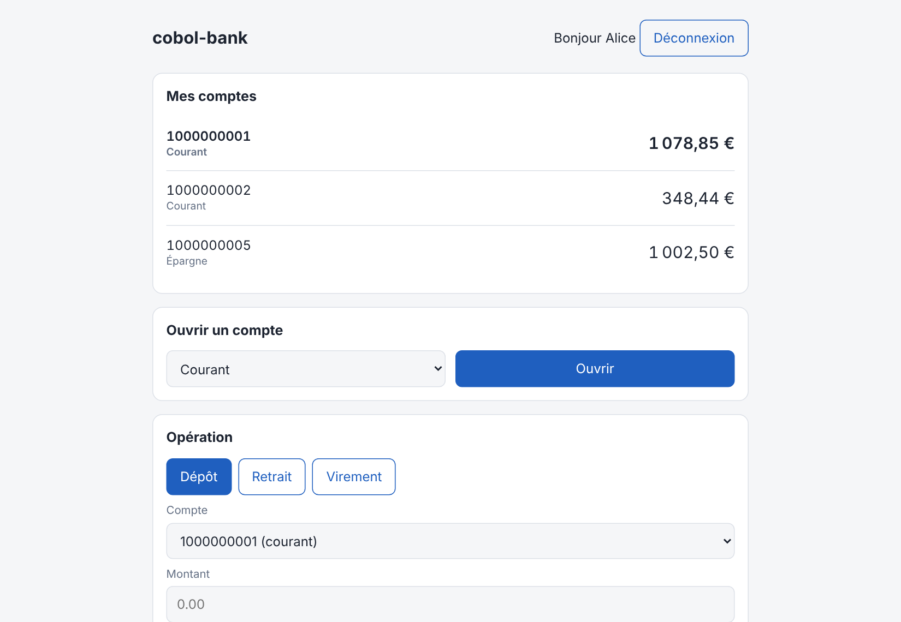
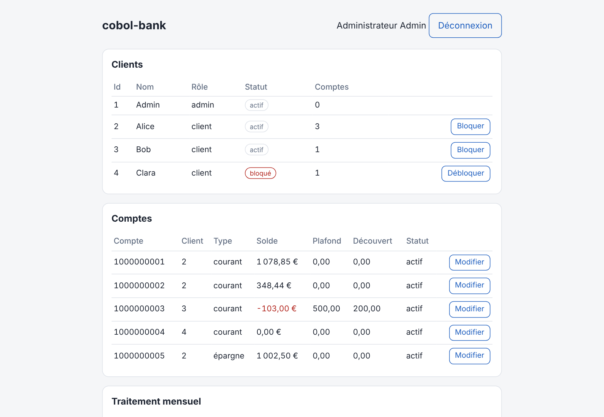

# cobol-bank

**A mini core-banking system written in GnuCOBOL**: indexed files, console menus, PIN authentication, current and savings accounts, overdraft, scheduled transfers, monthly interest/fees/overdraft-interest batch, basic fraud detection, printable statements, and a web UI backed by the COBOL code.

[](https://github.com/LoicRU/cobol-bank/actions/workflows/ci.yml)
[](LICENSE)


**Language:** English · [Français](README.fr.md)



> Educational project. The PIN hash is computed in pure COBOL (per-customer salt, 2000 rounds of arithmetic mixing): **it is not SHA-256** and must not protect real secrets. Data files are not encrypted.

## Why COBOL?

COBOL still runs a large share of the world's banking back-ends. This project rebuilds the core of such a system the way those systems are built: record layouts in copybooks, one program per responsibility, indexed files, a nightly/monthly batch, status codes returned by every module, and a transaction journal that lets any statement be audited. The web UI is deliberately thin: a small Python server validates input and calls the same COBOL programs as the console.

## Quick start

```
sudo apt install gnucobol      # tested with GnuCOBOL 3.1.2
make demo                      # builds demo data (never touches data/)
make web-demo                  # web UI on http://127.0.0.1:8080
make run-demo                  # or the console program on the same data
```

Demo logins (`make demo` prints them): `2` / `4321` (Alice, customer), `3` / `5555` (Bob, negative balance), `1` / `1234` (administrator).

Other targets: `make` (build), `make run`, `make web`, `make test`, `make clean`.

## Features

- **Authentication**: ID or name + PIN (4 to 6 digits), lock after 3 failures, fraud alerts, unlock by an administrator.
- **Accounts**: current accounts (optional overdraft) and savings accounts; active / frozen / closed status; per-account daily limit; self-service sign-up and account opening.
- **Operations**: deposit, withdrawal, atomic transfer. Every attempt, accepted or refused, is journaled with its reason.
- **Scheduled transfers**: one-off or monthly; executed on demand by the administrator through the normal transfer path (all rules apply); refused-for-funds transfers are retried; no duplicates on replay.
- **Monthly batch**: savings interest, account fees, overdraft interest (agios); replayable without duplicates (a processed period is refused).
- **Fraud detection**: daily outgoing limit (refusal), abnormal amount vs. account average (alert), repeated PIN failures (alert), alert journal for the administrator.
- **Statements**: formatted text or CSV over a period, with a consistency check (opening balance + credits − debits = closing balance).
- **Web UI** (customer and administrator): sign-up, accounts, operations, scheduled transfers, statement download, and for the administrator customers, accounts, alerts, batch and due transfers. The UI text is in French.

## Screenshots

| Customer | Administrator |
|---|---|
|  |  |

## Architecture

```
console (BANQUE)            web browser
      |                         |
      |                    web/server.py   strict validation, one COBOL call per request
      |                         |
      |                    bin/api (API)   one command in, one JSON line out
      +-----------+-------------+
                  |
   AUTH  COMPTE  TRX  FRAUDE  RELEVE  BATCH-INT  PROG  PARAM
                  |
     indexed / sequential files  (CLIENTS, COMPTES, TRANSACTIONS, ALERTES, BATCH, PROGRAMMES)
```

| Module | Role | Status codes |
|---|---|---|
| `BANQUE` | console menus (customer and administrator) | n/a |
| `API` | one customer or admin command as JSON for the web UI | codes of AUTH / COMPTE / PROG, 74, 77, 78, 79 |
| `AUTH` | login, PIN hash and change, lock, customer creation, sign-up | 81–85 |
| `COMPTE` | account lifecycle, deposit, withdrawal, transfer, limits | 00, 22, 23, 87, 88, 90–96, 98, 99 |
| `TRX` | transaction journal | 00 |
| `FRAUDE` | alert rules and journal | 00 |
| `RELEVE` | text/CSV statement with consistency check | 73–76 |
| `BATCH-INT` | monthly interest, fees, overdraft interest | 71–73 |
| `PROG` | scheduled transfers (create, list, cancel, execute due) | 10, 51–56 + COMPTE codes |
| `PARAM` | reads `config/parametres.cfg` | 61–63 |

Design rules: record layouts live in `copybooks/`; every module returns a status code instead of aborting; amounts are fixed-point (`PIC 9(9)V99`), never floating point; the web server never reaches the data files directly and never logs a PIN; the role is re-checked by COBOL on every request.

## Configuration

`config/parametres.cfg` (`KEY=value`, missing keys use defaults):

| Key | Default | Meaning |
|---|---|---|
| `PLAFOND_DEFAUT` | 1000.00 | default daily limit for new accounts |
| `TAUX_ANNUEL_PCT` / `TAUX_EPARGNE_PCT` | 1.50 / 3.00 | yearly interest rate, current / savings (%) |
| `FACTEUR_ANOMALIE` / `MIN_HISTORIQUE` | 5 / 3 | abnormal-amount alert: multiple of the account average, minimum history |
| `MAX_COMPTES_CLIENT` | 5 | accounts a customer may open (administrator unlimited) |
| `MAX_PROGRAMMES_CLIENT` | 10 | active scheduled transfers per customer |
| `MAX_INSCRIPTIONS_HEURE` | 20 | sign-ups per hour (above: refusal and alert) |
| `FRAIS_TENUE` | 2.00 | monthly account fee |
| `TAUX_AGIOS_PCT` | 12.00 | yearly overdraft interest rate (%) |
| `MAX_ECHECS_PIN` | 3 | PIN failures before lock |

Environment variables (mainly for tests): `PARAMS_FILE`, `CLIENTS_FILE`, `COMPTES_FILE`, `TRX_FILE`, `ALERTES_FILE`, `BATCH_FILE`, `BATCH_REPORT_DIR`, `RELEVE_DIR`, `PROGRAMMES_FILE`.

## Tests

`make test` builds and runs 11 suites, each ending with `TOUS LES TESTS PASSENT`: unit tests per module (`test_trx`, `test_param`, `test_compte`, `test_auth`, `test_batch`, `test_releve`, `test_epargne`, `test_prog`) and end-to-end shell suites for the console menus (`test_menu.sh`), the demo data (`test_demo.sh`) and the JSON API and HTTP server, including role checks, parameter injection attempts and PIN-free logs (`test_web.sh`). They run in CI on every push.

## Known limits

- Educational PIN hashing, unencrypted files, no HTTPS or sessions (the web server listens on 127.0.0.1 only).
- Single currency; date and time come from the system.
- Overdraft interest uses one rate on the opening balance of the period (not daily).
- Scheduled transfers: one-off or monthly only; due transfers run only when an administrator triggers them (no daemon); administrator cancellation is console-only.
- Statements are text or CSV; no PDF export.

The full documentation (menus, session examples, statement format, web API commands) is in [README.fr.md](README.fr.md), and the requirements specification in [CAHIER_DES_CHARGES.md](CAHIER_DES_CHARGES.md), both in French.

## Contributing

See [CONTRIBUTING.md](CONTRIBUTING.md). Licensed under the [MIT License](LICENSE).
